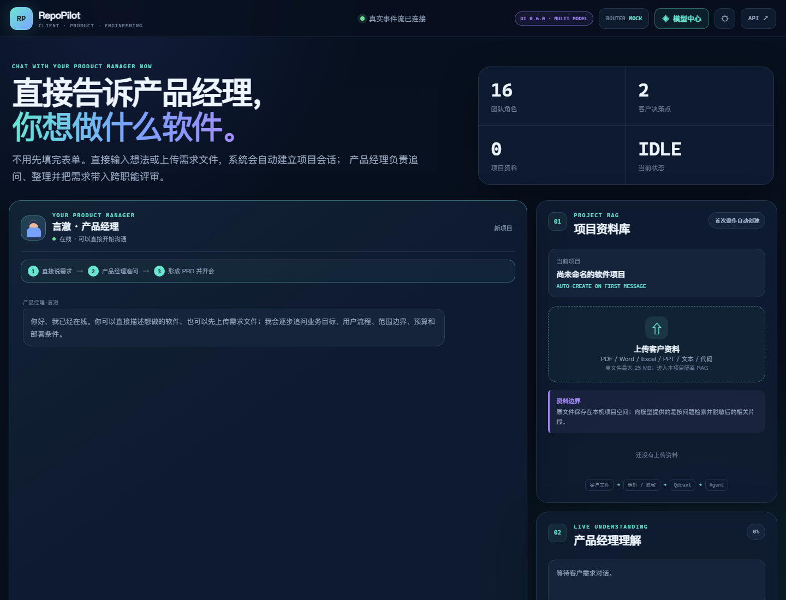

# RepoPilot 0.6.0

RepoPilot 是一个客户协作式多智能体软件公司：

```text
客户与产品经理多轮聊天 / 上传文件
→ 项目级 RAG
→ 交付总监需求避坑会
→ 客户确认 PRD
→ 项目规划与架构
→ 多语言开发
→ QA 测试与返工
→ 客户最终验收
→ ZIP 源码与详细指南交付
```

完整设计见 [项目.md](项目.md)。

## 界面预览

工作台以“软件公司”方式呈现客户、产品经理、总监和研发团队的协作过程。左侧是客户与产品经理的真实对话，中央是阶段进度和事件流，右侧可以查看需求、RAG 证据、人工审批和交付物。



> 截图来自本地 Mock 模式，仅展示界面，不包含任何 API Key。模型中心、上传文件、需求评审和发布审批的操作说明见 [快速开始](docs/QUICKSTART.md)。

## 功能

- 聊天优先首页：无需先填表，首次发送消息或上传文件时自动创建项目会话；
- 客户—产品经理持续项目会话；
- PDF、Word、Excel、PPT、文本和代码上传；
- Docling/pypdf 解析、秘密脱敏和项目隔离 RAG；
- 需求澄清会议、风险规避和任务拆解；
- Python、Java、Go、C++、TypeScript/JavaScript；
- LangGraph 双 Human-in-the-loop；
- 产物摘要绑定的双 Human-in-the-loop；
- 静态 QA 预检报告和最多两轮开发返工；
- SQLite 持久化 SSE 事件与跨重启原序号回放；
- 结构化输出校验和一次有界修复；
- 项目内部文档回写后供后续 Agent 再检索；
- 超详细环境、构建、测试、部署、使用、排障和回滚指南；
- 源码、PRD、会议、计划、架构、测试报告和清单 ZIP；
- DeepSeek‑V4‑pro、确定性 Mock 与 Agent 级多供应商模型路由；
- 前端 BYOK 模型中心、动态 `/models` 发现和自定义 OpenAI-compatible Base URL；
- DeepSeek、OpenAI、通义千问、豆包、智谱、Kimi、Gemini、ZZSHU、Ollama 和自定义兼容端点预设。

## 环境

项目使用：

```text
D:\envs\lstd
```

安装：

```powershell
cd D:\gptbot\RepoPilot
D:\envs\lstd\python.exe -m pip install -e .
```

如需复杂 PDF、Office、扫描件和表格解析：

```powershell
D:\envs\lstd\python.exe -m pip install -e ".[documents]"
```

## 配置

`.env` 示例：

```dotenv
REPOPILOT_LLM_MODE=deepseek
DEEPSEEK_API_KEY=你的密钥
DEEPSEEK_BASE_URL=https://api.deepseek.com
DEEPSEEK_MODEL=deepseek-v4-pro

REPOPILOT_RAG_EMBEDDING_PROVIDER=bge-m3
REPOPILOT_RAG_EMBEDDING_MODEL=BAAI/bge-m3
REPOPILOT_RAG_RERANKER_PROVIDER=bge
REPOPILOT_RAG_RERANKER_MODEL=BAAI/bge-reranker-v2-m3

# 限制维护工作流只能读取这些工作区；Windows 使用分号分隔。
REPOPILOT_WORKSPACE_ROOTS=D:\gptbot
# 远程访问必须配置 Bearer Token；仅 127.0.0.1 使用时可留空。
REPOPILOT_API_TOKEN=
# 默认禁止在宿主机执行仓库测试。
REPOPILOT_ALLOW_HOST_TEST_EXECUTION=0
# 默认阻止模型供应商 Base URL 访问本机或私网，避免 SSRF。
REPOPILOT_ALLOW_PRIVATE_MODEL_ENDPOINTS=0
```

不要把 `.env`、私钥或生产凭据上传到代码仓库。

### 前端 BYOK 与第三方模型

打开工作台右上角“模型中心”：

1. 选择供应商预设，或选择“自定义 OpenAI-compatible”；
2. 填写 Base URL 和 API Key；
3. 点击“测试连接并保存”，后端会优先调用 `/models`；
4. 如果供应商没有模型列表接口，填写模型 ID，系统会执行一次极小模型调用验证；
5. 选择单一、均衡、交叉审查或高级自定义路由；
6. 为产品、总监、项目、架构、开发、DevOps、QA 和发布审查 Agent 分配模型。

用户指定的 ZZSHU 网关已经预置：

```text
供应商：ZZSHU 第三方网关
Base URL：https://zzshu.cc/v1
协议：OpenAI-compatible
```

用户 API Key 仅保存在当前后端服务进程的内存中。浏览器不使用
`localStorage/sessionStorage` 保存密钥，项目会话、LangGraph Checkpoint、RAG、
Trace 和 ZIP 只保存 `credential_id`、供应商和模型。服务重启后需要重新连接
用户凭证；服务端环境变量托管的 DeepSeek 不受此限制。

Ollama、vLLM 和企业内网模型需要管理员显式设置
`REPOPILOT_ALLOW_PRIVATE_MODEL_ENDPOINTS=1`。公网端点必须使用 HTTPS。

## 启动

```powershell
cd D:\gptbot\RepoPilot
D:\envs\lstd\python.exe -m uvicorn repopilot.api:app --host 127.0.0.1 --port 8000
```

打开：

- 工作台：<http://127.0.0.1:8000/>
- API：<http://127.0.0.1:8000/docs>

## 项目会话 API

| 方法 | 路径 | 说明 |
| --- | --- | --- |
| POST | `/project-sessions` | 创建客户项目会话 |
| GET | `/project-sessions/{id}` | 读取项目会话 |
| POST | `/project-sessions/{id}/messages` | 与产品经理聊天 |
| POST | `/project-sessions/{id}/files` | 上传资料并进入 RAG |
| POST | `/project-sessions/{id}/launch` | 召开需求评审会 |
| GET | `/runs/{id}/events` | SSE 实时事件 |
| POST | `/runs/{id}/decision` | 客户确认/退回 |
| GET | `/runs/{id}/download` | 下载最终 ZIP |
| GET | `/model-providers/catalog` | 读取供应商预设 |
| GET/POST | `/model-providers/credentials` | 查询或连接本次进程的 BYOK 凭证 |
| POST | `/model-providers/credentials/{id}/refresh` | 重新发现模型 |
| DELETE | `/model-providers/credentials/{id}` | 从服务进程清除用户凭证 |
| POST | `/model-routing/validate` | 验证 Agent 级路由快照 |

## 测试

```powershell
cd D:\gptbot\RepoPilot
D:\envs\lstd\python.exe -m unittest discover -s tests -v
D:\envs\lstd\python.exe -m pip check
```

测试和检索评测使用独立临时运行目录，不会连接正在运行的服务所占用的
Qdrant Local，也不会写入生产 Qdrant 集合。因此可以在本地服务保持启动时执行：

```powershell
D:\envs\lstd\python.exe scripts\evaluate_retrieval.py
D:\envs\lstd\python.exe scripts\evaluate.py
```

真实 DeepSeek 极小端到端验收（会产生 API 费用，并自动批准本地测试项目的两个人工门禁）：

```powershell
D:\envs\lstd\python.exe scripts\smoke_deepseek_tiny_e2e.py
```

该脚本会上传一份极小规格，完整经过产品对话、项目 RAG、需求会议、双审批、代码生成、
QA、发布审查和 ZIP 交付；随后只对零第三方依赖且通过 AST 白名单的 Python 项目在临时
目录运行 `unittest`。它是受限冒烟验证，不等同于 Docker/gVisor/Firecracker 沙箱。

Qdrant Local 适合单进程本地演示，不支持多个进程或多个 Uvicorn Worker 同时打开
同一个存储目录。多进程、容器或团队环境请启动 `docker-compose.yml` 中的 Qdrant
Server，并设置 `REPOPILOT_QDRANT_URL`；不要通过复制本地存储目录绕过文件锁。

测试覆盖：

- 聊天与产品理解；
- 文件解析、项目隔离和秘密脱敏；
- 需求会议风险与拆解；
- 双人工审批；
- 多语言生成；
- QA 报告；
- 退回不写入；
- 原子交付与回滚；
- ZIP 内容和下载契约；
- 实时 SSE；
- SSE 事件跨服务重启回放；
- 过期审批摘要拒绝；
- 公开 API 不能注入内部知识目录；
- Studio Reviewer 不会截断源码后继续盲审；
- 宿主机测试默认禁用和危险 pytest 参数拒绝；
- RAG 增量索引和跨项目隔离。
- ZZSHU/自定义兼容地址、私网 SSRF 阻断和 BYOK 密钥脱离工作流状态；
- Agent 级模型解析以及开发—审查模型独立路由。

## 安全边界

RepoPilot 不会在未取得客户环境和授权时声称完成生产上线。生成的源代码默认不直接
在 RepoPilot 宿主机执行；真实构建、容器、数据库、网络和第三方集成测试应在隔离
CI 或客户目标环境执行，具体命令和预期结果写入 `DEPLOYMENT.md`。

维护仓库模式中的 pytest/unittest 同样默认禁止宿主机执行。只有设置
`REPOPILOT_ALLOW_HOST_TEST_EXECUTION=1` 才会对受信任本地仓库启用；此时仍会
清除密钥环境变量、隔离临时 HOME、禁用 pytest 自动插件并拒绝高风险参数，但这
不等同容器沙箱。
