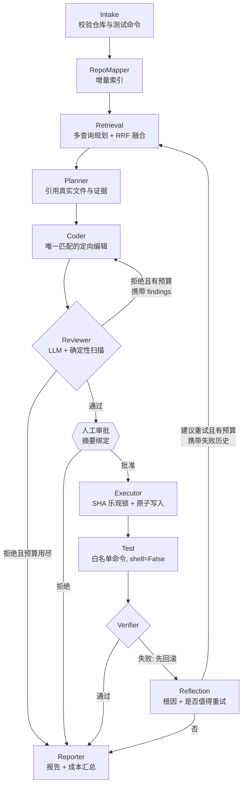
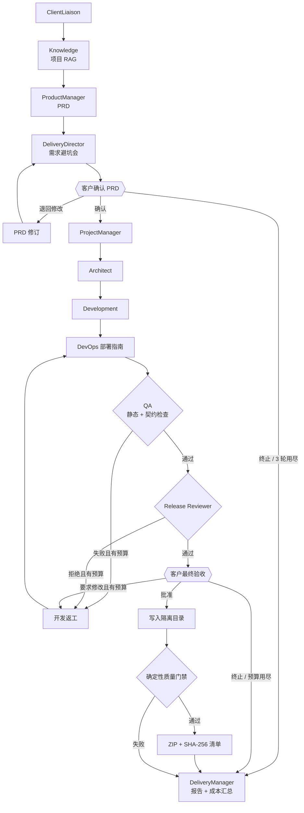

# Agent 设计

RepoPilot 有两条 LangGraph 工作流：

- **软件工作室**（`studio_workflow.py`）：从客户需求到可交付的 ZIP，是工作台默认流程；
- **仓库维护 Agent**（`workflow.py`）：针对已有仓库的 Issue → 补丁 → 测试，供 API、CLI 和 MCP 使用。

两条工作流的节点都由 LLM 负责“判断”，由确定性代码负责“边界”：模型可以提议，但写文件、执行测试、通过安全门禁和最终放行，都由程序规则或人来决定。

## 1. 设计原则

| 原则 | 落地方式 |
| --- | --- |
| 模型提议，程序把关 | Planner 引用的文件和证据 ID 必须真实存在；Coder 只能改 Plan 允许的文件，且编辑必须唯一匹配；危险代码与密钥由确定性扫描拦截，LLM Reviewer 无法放行 |
| 人在回路，且决定可追溯 | 每个人工门禁都把审批材料做 SHA-256 摘要，过期摘要会被拒绝；决定连同 `actor_id` 一起持久化 |
| 闭环但有预算 | 每个“失败 → 反馈 → 重做”回路都有独立预算，超出预算就带着完整记录结束，而不是无限重试 |
| 失败也是结构化状态 | 节点异常统一转成 `error` 状态，由 FailureReporter 回滚已写文件并生成报告；任何已结束的图都必须落在终态 |
| 上下文按角色裁剪 | 每个 Agent 的输入都按 schema 白名单和 token 预算做确定性压缩，路径、ID、哈希和 diff 改动行受保护 |
| 可观测 | 每个节点产出 trace（耗时、上下文压缩统计、检索统计、模型路由）；运行结束时汇总 LLM 调用次数、token 用量和各 Agent 耗时 |

## 2. 仓库维护 Agent：有界的自我修正

两个回路解决的是不同的问题：

| 回路 | 触发 | 反馈给谁、带什么 | 预算（默认） | 人工门禁 |
| --- | --- | --- | --- | --- |
| 审查修订（critic loop） | Reviewer 拒绝补丁 | Coder 收到 `review_feedback`：findings、摘要、被拒的 diff | `REPOPILOT_MAX_REVIEW_REVISIONS=1` | 修订后仍需过同一道审查 |
| 测试修复（Reflexion） | 已批准的补丁测试失败 | 先由 Verifier 回滚；Reflection 写入 `attempt_history`（diff、测试输出、根因、下一步），检索与 Planner 都能看到 | `REPOPILOT_MAX_REPAIR_ATTEMPTS=2` | **每个新补丁都要重新人工审批** |

几个关键取舍：

- **重试从检索重新开始，而不是直接让 Coder 再写一遍。** 失败的测试输出往往指向原先没检索到的代码，所以修复尝试会先用失败信息生成新的查询，再重新规划。
- **Reflection 决定值不值得重试。** 依赖缺失、测试环境故障这类问题，改代码修不好，Reflection 会返回 `retry_recommended=false`，避免浪费预算和人工审批次数。
- **每轮尝试都清空上一轮的产物**（补丁、审查、审批、写入结果），只把教训留在 `attempt_history` 里。这样新补丁一定会被完整地重新审查和审批，回滚记录也不会重复执行。
- **首轮的模型输入不受影响。** `previous_attempts` 和 `review_feedback` 只在存在时才发送，并从文件和证据预算中划出固定比例，不会挤掉 Issue 和 Plan。

## 3. 检索规划：多查询 + RRF

单一的“Issue 原文”查询有两个盲点：Issue 提到了函数名，但正文没有描述它；以及看不到上一次补丁为什么失败。Retrieval Agent 用确定性规则（不额外调用 LLM）最多生成三条互补查询：

| 查询 | 来源 | 作用 |
| --- | --- | --- |
| `issue` | Issue + 约束 | 语义意图 |
| `symbols` | 从 Issue 中抽取文件路径、`a.b.c`、`snake_case`、`camelCase` / `HTTPClient` | 精确命中被点名的代码 |
| `failure` | 上一次失败的 traceback 帧（过滤标准库/site-packages）、失败用例名、异常行，加上 Reflection 的根因 | 把检索引向真正出错的位置 |

每条查询分别走完整的混合检索，再按 chunk 做 Reciprocal Rank Fusion（k=60），重新编号为 `E1..En`。每条查询的命中路径和各阶段耗时都写进 trace。实现见 `rag/multi_query.py`。

## 4. 软件工作室：需求到交付

开发返工的反馈来源有三个：QA 缺陷、发布审查意见、客户的修改要求。它们**共享同一个返工预算**（`MAX_DEVELOPMENT_REVISIONS=2`），所以项目不会在开发和审查之间来回打转。返工节点根据进入时的状态判断这一轮的反馈来源（`feedback_source`），而不是读取残留字段，避免上一轮客户意见混进下一轮 QA 返工。

## 5. 人工决策契约

`POST /runs/{id}/decision` 的请求体：

| 字段 | 含义 |
| --- | --- |
| `approved=true` | 通过当前门禁 |
| `approved=false` + `comment` | **退回修改**：PRD 门禁回到产品经理；验收门禁回到开发团队（在预算内） |
| `approved=false` + `terminate=true` | **终止项目**：不再研发或交付，状态为 `cancelled` / `release_rejected` |
| `artifact_digest` | 必须与当前门禁材料的摘要一致，防止批准一个已经变化的产物 |

`approved` 和 `terminate` 同时为真会被拒绝。为兼容旧客户端，验收门禁上不带说明的拒绝按终止处理。工作台对应三个按钮：确认并继续、退回修改、终止项目（终止需要二次确认）。

## 6. 上下文与结构化输出

- **按角色压缩**：Planner、Coder、Reviewer、Reflection 各有 token 预算和字段白名单（`context.py`）。压缩是确定性的：先删无关证据、截断长文本，再按比例缩短非关键字符串；路径、证据 ID、哈希和 diff 的改动行永远保留。压缩后仍放不下就拒绝执行，不会盲审截断的源码。
- **结构化输出**：每个模型调用都绑定 Pydantic schema。校验失败时，只允许带着校验错误修复一次，仍然失败就进入失败边界。
- **工具恢复**：Coder 的定向编辑匹配不到唯一位置时，系统把目标文件全文作为只读 `read_file` 工具结果返回，并把 `tool_error` 一起交给模型，允许修复一次。

## 7. 失败边界与不变量

- 每个节点都包在 `guarded()` 里：异常转成结构化 `error`，图转入 FailureReporter，后者负责回滚已写入但未通过验证的文件。`GraphInterrupt`（人工审批信号）会被放行。
- 框架层异常（节点之外）由 `RepoPilotService._handle_framework_failure` 兜底，同样带回滚。
- **终态不变量**：图执行结束（没有后续节点）时，运行状态必须是终态，否则按框架失败处理。这条检查让“图跑完了但状态不是终态，导致 SSE 和等待方永远挂起”这类缺陷不会再静默出现。PRD 被连续退回到预算用尽时，就曾出现过这个问题，现已修复并补了回归测试。

## 8. 可观测性

- **Trace**：每个节点记录耗时、摘要和元数据，包括上下文压缩前后的 token 估算、模型路由、检索查询与各阶段耗时、修复轮次。
- **运行成本**：两个 Reporter 都会汇总 `run_metrics`：LLM 调用次数（含 schema 修复和工具修复，按 schema 分组）、压缩后输入 token、供应商返回的真实 token 用量，以及各 Agent 耗时排行。Mock 模式下同样能统计调用次数。
- **事件流**：SSE 事件先写入 SQLite 再推送，断线后可以凭 `Last-Event-ID` 续传；服务重启后会保留原有序号。

## 9. 测试覆盖

- `tests/test_agent_loops.py`：审查修订、审查预算用尽、Reflection 拒绝重试、修复轮次带失败历史重新规划、查询规划与 RRF 融合、成本汇总；
- `tests/test_workflow.py`：测试持续失败时完成全部修复预算（每轮都要重新审批），文件最终恢复原样；
- `tests/test_studio.py`：验收修改要求在预算内回到开发、PRD 门禁终止、PRD 退回超出预算后进入终态、发布审查拒绝的路由。
