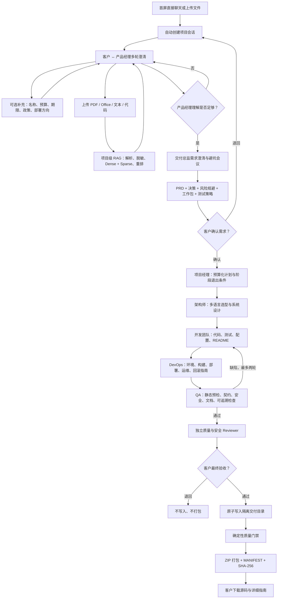
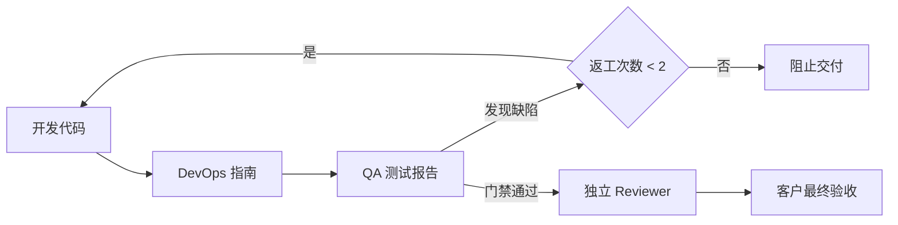

# RepoPilot 客户协作式多智能体软件公司落地方案

## 1. 项目定位

RepoPilot 不是“输入一句需求后直接生成代码”的工具，而是一套有人类决策约束的
软件项目协作与交付系统。

它模拟真实软件公司的工作方式：

1. 客户在首屏直接向产品经理输入想法或上传资料，系统自动创建持续项目会话；
2. 产品经理通过多轮聊天理解业务，而不是要求客户先填写一次性万能表单；
3. 客户可上传 PDF、Word、Excel、PPT、Markdown、文本、配置和代码资料；
4. 文件解析、脱敏、切块后进入该项目独立的 RAG；
5. 交付总监召集产品、架构、开发、测试、安全和 DevOps 开需求评审会；
6. 会议主动识别范围、政策、隐私、环境、预算、测试数据和上线责任等常见陷阱；
7. 客户确认 PRD 和会议结论后研发才能开始；
8. 代码完成后由独立 QA 形成需求可追溯测试报告，失败时打回开发返工；
9. 客户检查源码、测试限制、部署环境和交付边界后做最终验收；
10. 通过门禁后输出包含源码和完整指南的 ZIP。

## 2. 用户实际工作流



## 3. 前端信息架构

### 3.1 聊天优先的项目创建

首屏始终展示并启用客户—产品经理聊天框。客户第一次发送消息或上传文件时，
前端自动创建项目会话，不需要先完成表单。系统根据首条需求或文件名给项目生成
临时名称，产品经理随后继续澄清。

客户也可以在“项目边界补充（可选）”中提前提供：

- 项目名称；
- 目标用户；
- 预算；
- 交付时间；
- 技术偏好；
- 部署方向；
- 政策、法律、政治、商业和组织约束；
- Mock、服务端 DeepSeek 或 Agent 级多供应商模型路由。

这些字段不是开始聊天的前置条件。

### 3.2 产品经理聊天

中心区域是真实的客户—产品经理聊天：

- 支持多轮消息；
- 产品经理每轮更新“当前理解”；
- 展示已确认目标、约束、未解决问题和准备度；
- 上传资料后，产品经理回复显示其引用的 RAG Evidence ID；
- 只有产品经理认为关键业务信息足够时，才允许召集需求评审会。

### 3.3 项目资料库

左侧展示：

- 文件名与类型；
- 文件大小；
- 使用的解析器；
- 知识块数量；
- 敏感信息脱敏命中数；
- `客户文件 → 解析/脱敏 → Qdrant → Agent` 数据流。

### 3.4 需求会议室

用会议桌和人物动画表示交付总监主持会议，参会角色包括：

- 产品经理；
- 项目经理；
- 首席架构师；
- 开发负责人；
- 测试负责人；
- 安全审查官；
- DevOps 负责人。

会议输出分为：

- 关键决策；
- 避坑风险清单；
- 工作任务拆解；
- 测试策略；
- 交付边界；
- 尚未解决的问题。

### 3.5 研发流水线

页面明确显示八个阶段：

1. 需求与文件；
2. 需求避坑会；
3. 客户确认 PRD；
4. 项目规划与架构；
5. 开发与返工；
6. 测试与审查；
7. 客户最终验收；
8. ZIP 交付。

### 3.6 客户决策台

第一次决策展示：

- PRD；
- 范围内、范围外；
- 可量化验收标准；
- 会议风险及规避策略；
- 任务拆解和责任人。

第二次决策展示：

- 项目计划与架构；
- 所有待交付源代码文件；
- QA 报告；
- 已验证项和目标环境仍需执行项；
- 部署条件；
- 明确未完成、未授权和未上线的边界。

退回必须填写原因。

### 3.7 ZIP 交付中心

只有客户最终批准且质量门禁通过后，下载按钮才可用。

## 4. 后端领域模型

### 4.1 ProjectSession

项目会话在进入研发前持久化：

- `session_id`；
- 项目边界字段；
- 完整客户/产品经理消息；
- 产品经理当前理解；
- 上传资料元数据；
- 项目 RAG 路径；
- 对应工作流 `run_id`。

会话保存在：

```text
.repopilot/collaborations/{session_id}/session.json
```

项目知识文件保存在：

```text
.repopilot/collaborations/{session_id}/knowledge/
├── client/        # 客户上传原始资料
└── internal/      # PRD、会议、计划、架构、测试、部署文档
```

知识目录完全由服务端根据 `session_id/run_id` 生成；公开 `/projects` 请求不能
传入内部路径、会话摘要或伪造上传资产。知识账本写入前还会再次校验路径必须位于
`.repopilot/collaborations/`。

### 4.2 ProductUnderstanding

每轮对话更新：

- 统一需求摘要；
- 已确认目标；
- 约束；
- 开放问题；
- 假设；
- 是否可以召开跨职能评审会。

### 4.3 RequirementsWorkshop

包含：

- 参会角色；
- 客户意图；
- 明确决策；
- 未解决问题；
- 风险场景、影响、规避策略、预警信号和 Owner；
- 需求到开发/测试/运维工作包的拆解；
- 测试策略；
- 交付边界。

### 4.4 QualityAssuranceReport

每个测试项记录：

- `case_id`；
- 对应 `requirement_id`；
- 测试方法；
- `passed / failed / blocked / runtime_required`；
- 证据。

QA 不会把“没有真实运行环境”伪装成测试通过：

- 静态、契约、安全、文档和追溯性可以在 RepoPilot 中完成；
- 确定性框架契约会覆盖 LLM 的放行结论，包括异步测试 fixture、ORM 时间戳默认值
  和主版本配置迁移等可由源码与依赖清单共同证明的问题；
- 需要容器、数据库、真实网络或第三方系统的测试明确标记为
  `runtime_required`；
- 这些命令和预期结果写入客户指南，由隔离 CI 或客户目标环境执行。

报告同时记录 `validation_level=static_preflight`、`runtime_verified=false` 和
`runtime_validation_required=true`。界面中的 PASS 只表示静态交付前门禁通过，
不表示 Java/Go/C++/TypeScript 等项目已完成真实编译或运行。

## 5. 多智能体职责

| Agent | 真实岗位 | 主要产物 |
| --- | --- | --- |
| ClientLiaisonAgent | 客户成功顾问 | 商业背景与边界 |
| ProductManagerAgent | 产品经理 | 多轮需求理解与 PRD |
| KnowledgeAgent | RAG 研究员 | 文件和内部文档证据 |
| DeliveryDirectorAgent | 软件交付总监 | 需求评审会议与避坑清单 |
| RequirementsApprovalAgent | 需求确认协调员 | 第一道人类决策 |
| ProjectManagerAgent | 项目经理 | 预算、工期、阶段、人员、风险计划 |
| ArchitectAgent | 首席架构师 | 语言、组件、API、数据、安全、部署拓扑 |
| DevelopmentTeamAgent | 开发负责人 | 多语言项目与 QA 返工 |
| DevOpsAgent | DevOps 工程师 | 超详细部署、运行和运维指南 |
| QualityAssuranceAgent | 测试负责人 | 需求可追溯测试报告 |
| ReleaseReviewerAgent | 质量安全 Reviewer | 独立发布审查 |
| ReleaseApprovalAgent | 客户验收协调员 | 第二道人类决策 |
| DeliveryEngineerAgent | 交付工程师 | 原子写入 |
| QualityEngineeringAgent | 确定性质量门禁 | 哈希、语法、安全、文档检查 |
| DeliveryPackagingAgent | 交付打包员 | ZIP、清单和 SHA-256 |
| DeliveryManagerAgent | 客户移交经理 | 最终报告与下载入口 |

## 6. 项目级 RAG

### 6.1 支持文件

- PDF；
- DOC/DOCX；
- PPT/PPTX；
- XLS/XLSX；
- HTML；
- Markdown、TXT、CSV、JSON、YAML、XML；
- Python、Java、Go、C/C++、Rust、JS/TS 等代码。

### 6.2 解析策略

- 文本和代码使用结构感知解析；
- PDF 可使用 Docling，无法使用时退回 pypdf 文本抽取；
- Office、扫描 PDF、复杂表格优先使用 Docling；
- 校验扩展名和文件签名；
- 设置单文件大小与 PDF 页数上限；
- `.env`、私钥、credentials 等敏感文件不会被索引；
- API Key、Access Token、Password、私钥等模式在向量化前脱敏。

### 6.3 检索

```text
BGE-M3 Dense
+ 多语言代码/文档 Sparse
+ Qdrant
+ Reciprocal Rank Fusion
+ BGE Reranker
+ 每文档结果上限
```

全局行业知识和项目知识使用不同 `repo_id`，检索结果合并、去重并使用稳定 Chunk
证据 ID，
防止不同客户项目之间互相泄漏。

每个 Chunk 还保存 `document_version` 与 `trust_level`，区分客户上传资料、
工作流生成文档和仓库源码；文件变得过大、损坏或无法解析时会移除旧向量，禁止
继续检索已经失效的内容。

### 6.4 内部文档回写

以下产物生成后立即写入项目知识目录并增量重建索引：

- PRD；
- 需求评审会议纪要；
- 项目计划；
- 架构；
- 生成代码文件清单；
- 测试报告；
- 部署指南。

因此后续 Agent 可以检索前序真实产物，而不是只依赖越来越长的聊天上下文。
每次 Agent 调用都会按当前任务重新查询最多 6 条项目记忆，并在 Trace 中记录实际
使用的稳定 Evidence ID。

## 7. 测试与返工



确定性规则优先于 LLM：

- 发现秘密、危险执行、路径问题时强制失败；
- Python 源码使用 AST 检查；
- JSON 做实际解析；
- 已写入文件和已审查内容做 SHA-256 对比；
- 必须存在 README 和超详细部署指南；
- 不在 RepoPilot 宿主机直接执行不可信 LLM 生成项目代码；
- 维护仓库测试默认关闭，只有显式信任时才允许宿主机执行，且会清空凭据环境、
  禁用 pytest 自动插件和危险参数。

## 8. 客户详细指南

`DEPLOYMENT.md` 至少包含：

1. 交付物说明和目录结构；
2. 主语言、版本、操作系统、CPU、内存、网络和存储要求；
3. 前置软件安装；
4. 环境变量名称、用途、是否必填和安全存储方式；
5. 本地运行；
6. 可复现构建；
7. 单元、静态、契约、安全和目标环境测试；
8. Docker/内网/Kubernetes/云等目标部署步骤；
9. 健康检查、Smoke Test 和预期响应；
10. 最终用户使用方法；
11. 日志、指标和告警；
12. 常见故障的症状、诊断和处理；
13. 备份与恢复；
14. 回滚；
15. 安全上线检查；
16. 客户移交检查；
17. 已完成、未完成、客户负责和需要额外授权的边界。

系统不会声称已经完成以下未授权动作：

- 购买或创建云资源；
- 创建域名、证书、数据库或第三方账号；
- 获取客户生产凭据；
- 执行真实生产部署；
- 完成依赖真实业务系统的集成测试。

## 9. ZIP 结构

```text
project.zip
├── README.md
├── DEPLOYMENT.md
├── MANIFEST.json
├── Dockerfile / build manifest
├── src/...
├── tests/...
└── docs/
    ├── PRD.md
    ├── REQUIREMENTS_WORKSHOP.md
    ├── PROJECT_PLAN.md
    ├── ARCHITECTURE.md
    └── TEST_REPORT.md
```

`MANIFEST.json` 保存：

- 项目与工作流 ID；
- 所有交付文件；
- 文件用途；
- 每个文件的 SHA-256；
- “生成代码未在 RepoPilot 宿主机直接执行”的运行边界。

## 10. API

| API | 用途 |
| --- | --- |
| `POST /project-sessions` | 创建客户项目会话 |
| `GET /project-sessions/{id}` | 恢复项目会话 |
| `POST /project-sessions/{id}/messages` | 与产品经理聊天 |
| `POST /project-sessions/{id}/files` | 上传并索引项目资料 |
| `POST /project-sessions/{id}/launch` | 冻结需求并召开评审会 |
| `GET /runs/{id}/events` | 实时 SSE Agent 事件 |
| `POST /runs/{id}/decision` | 客户确认或退回 |
| `GET /runs/{id}` | 获取工作流状态与产物 |
| `GET /runs/{id}/download` | 下载已批准 ZIP |
| `GET /model-providers/catalog` | 读取内置供应商与能力预设 |
| `GET /model-providers/credentials` | 读取脱敏后的当前进程凭证 |
| `POST /model-providers/credentials` | 验证并连接用户 BYOK 凭证 |
| `POST /model-providers/credentials/{id}/refresh` | 重新发现供应商模型 |
| `DELETE /model-providers/credentials/{id}` | 从服务进程清除用户凭证 |
| `POST /model-routing/validate` | 校验 Agent 级路由快照 |

旧的 `/projects` 和 `/runs` 仍保留兼容。

审批请求必须回传当前 Interrupt 中的 `artifact_digest`，系统同时记录
`actor_id`。材料变化或页面过期会返回冲突，不能批准未实际查看的版本。

## 11. 多供应商模型路由落地方案

### 11.1 前端模型中心

前端提供三层使用方式：

- 快速模式：全部 LLM Agent 使用同一个已验证模型；
- 推荐模式：按需求规划、架构开发、测试审查三类能力自动分配；
- 专家模式：逐个配置八个调用 LLM 的软件公司 Agent。

内置供应商预设包括 DeepSeek、OpenAI、通义千问、豆包、智谱、Kimi、
Gemini、Ollama、ZZSHU 和自定义 OpenAI-compatible。ZZSHU 默认地址为
`https://zzshu.cc/v1`，但仍必须由用户提供有效 API Key，RepoPilot 不内置或
共享第三方凭证。

### 11.2 模型发现与手动兜底

连接供应商时：

1. 校验 URL、协议和解析后的目标地址；
2. 公网地址强制 HTTPS；
3. 默认拒绝回环、私网、链路本地、保留和云元数据类地址；
4. 使用供应商 `/models` 动态读取模型；
5. `/models` 不可用时要求用户填写模型 ID，并执行极小模型调用验证；
6. 路由校验确认凭证存在、模型属于发现列表、Agent 名合法。

模型名称不写死在前端。每个凭证返回自己的模型列表，Agent 下拉框随凭证变化。

### 11.3 路由与运行时

`ModelRoutingConfig` 仅包含：

```json
{
  "preset": "cross_review",
  "default_route": {
    "credential_id": "cred:...",
    "model": "provider-model-id"
  },
  "agent_routes": {
    "DevelopmentTeamAgent": {
      "credential_id": "cred:...",
      "model": "coding-model"
    },
    "ReleaseReviewerAgent": {
      "credential_id": "cred:...",
      "model": "independent-review-model"
    }
  }
}
```

项目会话创建时验证并冻结路由，随后进入 LangGraph State 和 Checkpoint 的只有
这份无密钥快照。每次结构化调用根据 schema 映射到真实 Agent，再解析凭证和模型；
Trace 记录 Agent、供应商、模型、Token 和耗时，但不记录 API Key。

RAG、客户审批、原子写入、质量门禁、打包和移交 Agent 不调用聊天模型，因此前端
不向这些角色展示无意义的供应商选择。

### 11.4 凭证边界

- 用户 API Key 只保存在当前服务进程内存；
- 浏览器不得写入 `localStorage`、`sessionStorage` 或 IndexedDB；
- API 响应只返回掩码和 `credential_id`；
- Key 不进入会话 JSON、SQLite Checkpoint、RAG、Prompt、SSE、Trace 和 ZIP；
- 删除凭证时同步关闭并清除对应的已缓存模型客户端；
- 服务重启后用户 BYOK 凭证失效，需要重新连接；
- 服务端环境变量凭证属于托管凭证，不能从前端删除；
- 生产多租户版应使用 KMS/Secret Manager，并把凭证与组织、项目和审计策略绑定。

## 12. 技术栈

- Python 3.11；
- FastAPI；
- LangGraph；
- Pydantic；
- DeepSeek‑V4‑pro 与 OpenAI-compatible 多供应商适配器；
- BGE-M3；
- BGE Reranker；
- Qdrant；
- Docling / pypdf；
- SQLite Checkpoint；
- SQLite 追加式 Run Event Store；
- SSE；
- 原生 HTML/CSS/JavaScript。

## 13. 当前边界与下一阶段

当前版本完成的是本地单用户/小团队可运行的软件公司项目工厂。生产化建议：

1. 会话、运行和文件元数据迁移 PostgreSQL；
2. Qdrant 改为独立服务；
3. 原始文件进入对象存储并增加 KMS 加密；
4. 当前已有本地 Bearer Token/仅回环地址保护；生产加入 OIDC、用户、组织、
   RBAC 和不可篡改审计日志；
5. 使用容器沙箱执行语言真实构建和测试；
6. 增加病毒扫描与内容安全网关；
7. 接入 Git 平台和 CI/CD；
8. 在客户显式授权后增加云平台部署适配器。
9. 为 Anthropic 等非 OpenAI-compatible 服务增加原生 Provider Adapter；
10. 使用 KMS/Secret Manager 实现多租户持久凭证与细粒度成本配额。

其中 Qdrant Local 明确只作为单进程开发模式：它不能被在线服务、测试进程和多个
Uvicorn Worker 同时打开。仓库内测试与检索评测已强制使用独立临时向量库；正式
多进程部署必须设置 `REPOPILOT_QDRANT_URL` 接入 Qdrant Server。
