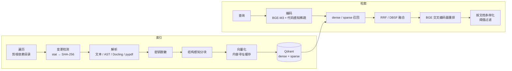

# RAG 设计

RepoPilot 的检索服务三类调用方：仓库维护 Agent 检索代码，软件工作室检索客户资料和项目内部文档（PRD、会议纪要、架构、测试报告写回后可再检索），以及 MCP 的 `search_code` 工具。三者共用 `rag/` 包，每个仓库或项目用 `repo_id` 隔离在同一个 Qdrant collection 中。



## 1. 索引

**遍历**：`os.walk` 在遍历阶段剪掉 `node_modules`、`.git`、`.venv`、`dist` 等目录和所有 `.repopilot*` 运行目录，并且不跟随指向目录的符号链接。旧实现先用 `rglob` 走遍整棵树再过滤，在含 3000 个依赖文件的仓库上耗时 800 ms，现在是 7.8 ms。

**变更检测（两级）**：

1. 文件大小和 mtime 都与清单一致 → 直接复用，不读文件；
2. 否则读取文件并计算 SHA-256，哈希一致就复用并刷新 mtime，不一致才重新解析。

这和 git 的 index stat 缓存是同一个思路，也处理了同样的 “racy” 问题：如果文件在被哈希前 2 秒内修改过，它的 mtime 不被信任（清单里记为 0），下一次一定重新哈希。这样，粗粒度时间戳的文件系统上“同一时间片内再次修改”的情况不会被漏掉。Agent 每次运行、产品经理每轮对话都会触发增量索引，这一步决定了它们的固定开销。

**分块**：Python 按 AST 的函数/类边界切分，Markdown 按标题层级切分，其他语言按通用符号模式切分，富文档保留页码。超过 token 预算的块按行滑窗切分并带重叠。每一行只分词一次。每个块带上 `path / section / symbol` 前缀再向量化，让同名函数在不同文件中可以区分开。

**内容寻址的向量缓存**：块 ID 编码了位置，所以文件一改，ID 就全变了，但大部分块的文本其实没变。`CachedHybridEmbedding` 按 `sha256(模型 ID + 稀疏模型 ID + 块文本)` 缓存 float32 向量，存在 SQLite 里并按最近使用淘汰。编辑一个函数后重新索引，只有文本真正变化的块会送进 BGE-M3。collection 因为 schema 升级或丢失而重建时，所有向量都能从缓存恢复。查询不缓存：单次编码很便宜，而且缓存会把用户问题落盘。

**自愈**：每个进程第一次索引某个仓库时，会对比清单记录的块数和 Qdrant 中的实际点数，不一致就重建。这覆盖了 collection 被重建、存储从旧备份恢复、或在写入向量和写入清单之间崩溃等情况。旧实现只用一个全局的 “collection 刚被创建” 标志，在多仓库场景下只有第一个仓库会重建，其余仓库的清单指向已经不存在的向量，检索结果会悄悄变成空。

**Schema 指纹**：collection 名包含 schema 版本、稠密模型、稀疏分析器版本和向量维度的哈希。任何一项变化都会自动换到新 collection，旧清单随之失效。

## 2. 检索

**混合召回**：稠密向量（BGE-M3，1024 维，余弦）负责语义；稀疏向量负责精确词项，由 Qdrant 的 `Modifier.IDF` 提供语料级 IDF。

**代码感知的稀疏分析器（v3）**：

- 完整标识符保留为精确匹配词项：`safe_divide`、`targetededitmismatch`；
- 再拆出 snake_case 和 camelCase 的组成部分，并保留缩写：`HTTPServerError` → `http`、`server`、`error`，这样 “safe divide” 这类自然语言查询也能和代码重合；
- 英文复数做轻量还原：`versions` → `version`，`retries` → `retry`；
- 中文使用单字加二元组。

**融合**：默认 RRF；也可以选 DBSF（基于分布的分数归一化），供消融对比。

**重排与多样化**：BGE reranker 对候选（默认 32 个）打分，低于阈值的丢弃，同一文档最多保留 3 个块，避免一个大文件占满 Top-K。

**可观测**：每次检索返回 `RetrievalStats`，包含查询编码、召回/融合、重排各阶段耗时和候选漏斗大小。Agent 把它写进 trace。`SearchOptions` 可以单独关闭任一阶段，生产调用和消融实验走的是同一条代码路径。

## 3. 评测方法

- **用例**：`evals/retrieval_cases.jsonl`，34 条带标注的查询，分五类：精确标识符、中文自然语言、英文自然语言、中文文档问答、英文文档问答。代码检索用例以 `src/` 为语料，文档问答以 `knowledge_base/` 为语料，计算器示例单独成库。
- **防泄漏**：用例文件是 `.jsonl`，不在可索引的后缀名单里；生成的报告只写用例 ID 和指标，不写查询原文。
- **公平对比**：`--corpus-root` 可以指向冻结的语料快照，比较两版代码时语料完全一致；每个仓库只索引一次，所有配置查询同一个 collection。
- **指标**：文件级 Hit@1、Recall@5、MRR、nDCG@5（理想排序按 k 个位置计算，不受返回条数影响），以及端到端延迟 p50/p95 和各阶段平均耗时。
- **CI 门禁**：每次提交都用离线的确定性模型跑生产配置，Recall@5 或 MRR 低于阈值就失败。

运行方式：

```powershell
# 离线、确定性模型（CI 同款）
python scripts\evaluate_retrieval.py --min-recall 0.65 --min-mrr 0.6
# 真实 BGE 模型 + 全部消融配置 + Markdown 报告
python scripts\evaluate_retrieval.py --ablation --production-models --report docs\RAG_EVALUATION.md
```

## 4. 结果

### 消融（真实模型）

BGE-M3 + bge-reranker-v2-m3，CPU，冻结语料 543 个知识块。完整报告（含各类查询的分项指标和各阶段耗时）见
[RAG_EVALUATION.md](RAG_EVALUATION.md)。

| 配置 | Hit@1 | Recall@5 | MRR | nDCG@5 |
| --- | ---: | ---: | ---: | ---: |
| dense | 0.706 | 0.863 | 0.784 | 0.794 |
| sparse | 0.618 | 0.706 | 0.657 | 0.669 |
| hybrid（RRF） | 0.735 | 0.863 | 0.804 | 0.811 |
| hybrid（DBSF） | 0.765 | 0.833 | 0.800 | 0.804 |
| hybrid + rerank | 0.853 | 0.897 | 0.882 | 0.879 |
| 生产配置（+ 多样化） | **0.853** | **0.897** | **0.882** | **0.879** |

结论：

- **重排贡献最大**：在混合召回的基础上 MRR 提升 0.078（0.804 → 0.882），中文自然语言查询从 0.569 提升到 0.792。
- **稠密和稀疏互补**：稀疏检索的精确标识符查询 MRR 为 1.000，但中文自然语言只有 0.250；稠密检索恰好相反（0.817 / 0.667）。融合后，标识符和文档问答两类都在 0.95 以上。
- **RRF 和 DBSF 基本持平**：DBSF 的 Hit@1 略高、Recall 略低。默认使用 RRF，因为它只依赖排名，不需要两路分数可比。
- **多样化**在这个基准上不改变文件级指标：它防止的是同一文件的多个块占满 Top-K，而文件级评测会先去重，所以看不出差别；它的价值在于给 Agent 的证据覆盖面。

### 稀疏分析器 A/B（v2 → v3）

同一冻结语料、同一组模型，只换稀疏分析器：

| 分析器 | sparse MRR | hybrid（RRF）MRR | 生产配置 MRR |
| --- | ---: | ---: | ---: |
| v2：原始 token | 0.613 | 0.819 | 0.882 |
| v3：标识符拆分 + 复数还原 | 0.657 | 0.804 | 0.882 |

v3 让稀疏检索单独使用时的 MRR 提升 0.044，其中英文自然语言查询从 0.25 提升到 0.50；生产配置的结果不变。不开重排的混合检索下降 0.015，原因是一个标识符用例从第 1 名掉到第 2 名。最终保留 v3：它解决了“用自然语言描述 `snake_case` 函数时匹配不到”的问题，也不影响生产结果。如果为了延迟关闭重排，应先用本脚本重新评估。

### 延迟

CPU 上重排是绝对瓶颈：每次查询平均约 33.6 s（32 个候选 × 最长 1024 token，XLM-R large 交叉编码器），查询编码和向量召回合计约 0.18 s。生产部署应使用 GPU；只能用 CPU 时，可以调低 `REPOPILOT_RAG_CANDIDATE_K` 或 `REPOPILOT_RAG_RERANKER_MAX_LENGTH`，再用本脚本复测质量。

### 离线模型（CI 基线）

CI 使用确定性的测试替身模型，在实时语料上，生产配置为 Hit@1 0.618、Recall@5 0.706、MRR 0.652。这组数字只用来发现回归，不代表真实检索质量。

## 5. 已知局限

- Qdrant Local 是进程内的暴力检索，适合单进程演示；多进程或团队部署应使用 Qdrant Server（`docker-compose.yml`），并为 `repo_id`、`document_id` 等字段建立 payload 索引（Server 模式下会自动创建）。
- stat 快速路径假设“内容变了，大小或 mtime 至少有一个会变”。会刻意保留 mtime 的工具（例如某些解压和同步工具）可能让内容变化被漏掉；出现这种情况时，删除对应清单即可强制全量重建。
- 评测集规模较小（34 条），适合发现回归和比较各阶段的贡献，不足以给出有统计显著性的绝对指标。
